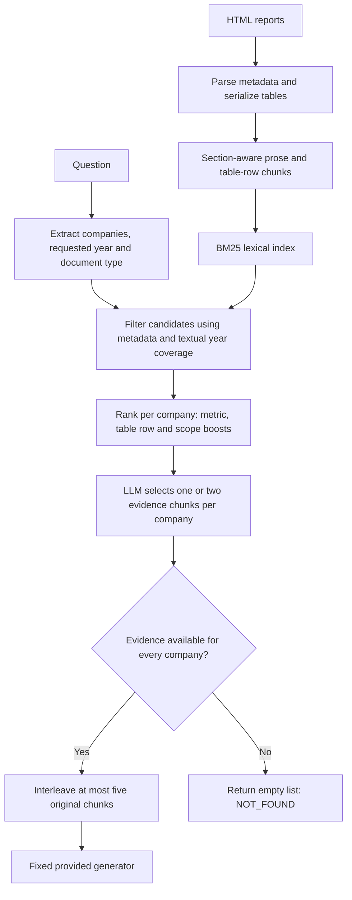

# FTEC5660 Homework 4

## Homework 4 solution

### Pipeline

HTML tables are serialized with each row label, column year and printed value together, including the caption and its units. The final parser creates separate table-row and prose chunks, with section/caption context, a maximum of 1,500 characters, and source, company, fiscal-year and document-type metadata. BM25 provides lexical retrieval without embeddings. The question parser extracts all requested companies, including absent companies; word boundaries prevent “operating” from being classified as a broker “rating”. Exact company and document-type filtering prevents similarly named companies from being confused. A passage may inherit its document year for prose; prior-year table data and forecasts can be retrieved through their explicitly printed years. Normalized tokens and generic financial-concept rules boost exact financial rows and the requested segment or region. Up to twelve lexical candidates per company are passed to the permitted model for evidence selection. Comparison evidence is selected separately for each company and interleaved, with at most five original chunks returned. An unknown company, absence of year/type candidates, or an empty evidence selection causes abstention. No generated text is inserted into chunks; the final answer is written by the unchanged provided generator.

### Experimental setup

All nine configurations use the same 40-document, 60-question public test set, the provided generator, the same model settings, and the same five-chunk limit. The generator and official scoring code are unchanged. Each variant is executed in a fresh Python process. B0 uses BeautifulSoup get_text, RecursiveCharacterTextSplitter (1,450 characters, overlap 150), required metadata, and rank_bm25 with lowercased whitespace tokens over the whole corpus. It does not parse questions and never abstains. Adjacent variants change exactly one configured component, but the unchanged query parser is called again in each process and its outputs can vary; a component's internal subrules are enabled together and are not interpreted as independently measured effects. No gold labels are used by indexing, query parsing, retrieval, or evidence selection. Gold data is read by the official scorer and this report generator only after predictions. Results below come from the CSV and logs produced by each configuration, with retained source hashes and evidence traces. Runs are not assumed to be bitwise deterministic, even at temperature zero.

### Cumulative ablation

| Variant | Single component changed from previous row | Recall@5 | Kept | Rejected | Answer accuracy | Seconds | API calls | Estimated USD |
|---|---|---:|---:|---:|---:|---:|---:|---:|
| B0 | Naive: get_text + recursive splitter + whitespace BM25; global top-5 | 39.1% | 100.0% | 0.0% | 51.7% | 11.2 | 60 | 0.0175 |
| V1 | B0 + table_to_text serialization (same recursive splitter) | 34.8% | 100.0% | 0.0% | 50.0% | 11.0 | 60 | 0.0172 |
| V2 | V1 + section-aware prose / table-row chunks with contextual headers | 15.2% | 100.0% | 0.0% | 35.0% | 10.6 | 60 | 0.0047 |
| V3 | V2 + normalized tokenization, stopwords and removal of entity boilerplate | 37.0% | 100.0% | 0.0% | 46.7% | 11.6 | 60 | 0.0046 |
| V4 | V3 + parsed company/type/year filtering (metadata-aware year rules) | 87.0% | 97.8% | 50.0% | 95.0% | 72.2 | 112 | 0.0069 |
| V5 | V4 + per-company slots for comparisons | 89.1% | 100.0% | 50.0% | 96.7% | 71.6 | 113 | 0.0069 |
| V6 | V5 + financial metric expansion and table/row/scope/year score boosts | 97.8% | 97.8% | 50.0% | 96.7% | 70.0 | 112 | 0.0069 |
| V7 | V6 + LLM evidence selection; empty selections fall back to lexical top-2 | 100.0% | 100.0% | 50.0% | 100.0% | 141.4 | 178 | 0.0200 |
| V8 | V7 + evidence-level abstention; final submitted implementation | 97.8% | 97.8% | 100.0% | 98.3% | 139.9 | 169 | 0.0194 |

Kept is the share of answerable questions returning evidence; Rejected is the share of unanswerable questions returning no chunks. These distinguish false abstention from correct rejection. The scored parse field is not meaningful for B0–V3 because query parsing is deliberately disabled there. Model-call counts and estimated costs include both retrieval-side calls and the fixed generator, using the assignment's price constants rather than billing statements. V4 introduces legitimate empty results through metadata filtering; V8 adds evidence-level rejection, rather than claiming to introduce all forms of abstention.

### Analysis of each change

**V1.** Table serialization preserves row/column/value associations while leaving the splitter and retrieval unchanged. Observed answer accuracy reduced (-1.7 percentage points); recall changed by -4.3 points, kept by +0.0, and rejected by +0.0. This run does not establish an accuracy benefit for this component; an unchanged or negative result is retained rather than omitted. These are conditional, single-run public-set effects, not proof of independent causal gains or private-set performance.

**V2.** Structural chunking replaces fixed splitting and adds section/caption context, reducing ambiguity around financial rows. These are one chunking-policy component, not separately measured interventions. Observed answer accuracy reduced (-15.0 percentage points); recall changed by -19.6 points, kept by +0.0, and rejected by +0.0. This run does not establish an accuracy benefit for this component; an unchanged or negative result is retained rather than omitted. These are conditional, single-run public-set effects, not proof of independent causal gains or private-set performance.

**V3.** The tokenization/query-normalization component removes boilerplate and entity terms and normalizes punctuation, keeping the scoring policy otherwise unchanged. Observed answer accuracy improved (+11.7 percentage points); recall changed by +21.7 points, kept by +0.0, and rejected by +0.0. The observed change is consistent with a benefit in this configuration, subject to the parser-output confounding discussed below. These are conditional, single-run public-set effects, not proof of independent causal gains or private-set performance.

**V4.** The metadata-filtering component introduces query parsing and exact company/type/year coverage, preventing wrong-entity and unsupported-year retrieval. It can also return an empty result when no eligible document exists. Observed answer accuracy improved (+48.3 percentage points); recall changed by +50.0 points, kept by -2.2, and rejected by +50.0. The observed change is consistent with a benefit in this configuration, subject to the parser-output confounding discussed below. These are conditional, single-run public-set effects, not proof of independent causal gains or private-set performance.

**V5.** Per-company slot allocation protects comparison questions from one company occupying all five positions. Observed answer accuracy improved (+1.7 percentage points); recall changed by +2.2 points, kept by +2.2, and rejected by +0.0. The observed change is consistent with a benefit in this configuration, subject to the parser-output confounding discussed below. These are conditional, single-run public-set effects, not proof of independent causal gains or private-set performance.

**V6.** The financial-ranking component adds concept expansion, exact table-row boosts, scope matching and a same-year preference; their individual contributions are not separately identified. Observed answer accuracy did not change (+0.0 percentage points); recall changed by +8.7 points, kept by -2.2, and rejected by +0.0. This run does not establish an accuracy benefit for this component; an unchanged or negative result is retained rather than omitted. These are conditional, single-run public-set effects, not proof of independent causal gains or private-set performance.

**V7.** The LLM evidence selector reranks the twelve lexical candidates for each company. Empty selections still fall back to lexical evidence, isolating reranking from evidence-level abstention. Observed answer accuracy improved (+3.3 percentage points); recall changed by +2.2 points, kept by +2.2, and rejected by +0.0. The observed change is consistent with a benefit in this configuration, subject to the parser-output confounding discussed below. These are conditional, single-run public-set effects, not proof of independent causal gains or private-set performance.

**V8.** Evidence-level abstention accepts an empty model selection instead of falling back to lexical candidates. It can improve rejection while risking false refusals on answerable questions. Observed answer accuracy reduced (-1.7 percentage points); recall changed by -2.2 points, kept by -2.2, and rejected by +50.0. This run does not establish an accuracy benefit for this component; an unchanged or negative result is retained rather than omitted. These are conditional, single-run public-set effects, not proof of independent causal gains or private-set performance.

### Interpretation of non-monotonic results and parser confounding

The cumulative curve is not monotonic. Table serialization alone (V1) lowers recall from 39.1% to 34.8%, and structural chunking without metadata filtering (V2) lowers it further to 15.2%. Inspection of q002 illustrates the failure: V1 still retrieves a long passage containing Brightwater Software's exact revenue and answers 1574.7; V2 instead returns short “Key takeaways” passages from five other companies and answers NOT_FOUND. Splitting a report into small, well-formed rows does not itself make global lexical ranking entity-aware. It also changes document lengths and BM25 term statistics. These observations explain why the parsing improvements require compatible filtering and ranking rather than guaranteeing isolated recall gains.

V4 produces the largest observed accuracy change, from 46.7% to 95.0%, consistent with the importance of exact company/type/year constraints. V6 increases recall from 89.1% to 97.8% without changing answer accuracy: q027 (headquarters) and q031 (net-income comparison) are fixed, while q007 and q060 become incorrect. In V5, q027 retrieves employees/footer chunks rather than a headquarters passage, and q031 retrieves ambiguous prose/heading chunks. Metric and scope ranking in V6 corrects these failures.

**Query-parser variability prevents strict causal attribution of several small differences.** For q007, V4, V6 and V8 parse both Brightwater Energy and its broker Kowloon Peak Securities as target companies; V5 and V7 correctly parse only Brightwater Energy. Since the broker is not a company covered by the corpus, the unchanged metadata filter returns no evidence in V4/V6/V8 before the model evidence-selection step is reached. Thus the V4→V5 one-question gain cannot be attributed to comparison-slot allocation (q007 is not a comparison), and the V7→V8 loss cannot be attributed to evidence-level abstention. V6→V7 also includes correction of this parser fluctuation. A stronger follow-up experiment would replay one fixed, model-produced query parse across V4–V8 or repeat each configuration; this report does not claim that such a control was run.

V8 does improve retrieval-side rejection from 50% to 100%. V7 already answers all unanswerable questions correctly because the fixed generator can output NOT_FOUND even when the retriever supplies irrelevant chunks. Retrieval rejection and final answer accuracy therefore measure different behavior. V8's 98.3% answer accuracy in this run is consistent with the q007 parsing failure rather than evidence that stricter evidence selection is inherently worse. A previous standalone run of the same final source reached 100%; the ablation table intentionally retains this run's actual 98.3% instead of substituting the earlier result.

### Error analysis

- **B0**: 29 wrong; 0 false abstentions; 27 errors with missing evidence; 1 wrong answers despite complete evidence; 1 failures on unanswerable questions.
- **V1**: 30 wrong; 0 false abstentions; 30 errors with missing evidence; 0 wrong answers despite complete evidence; 0 failures on unanswerable questions.
  Fixed from preceding variant: q026, q042, q044. Regressions: q004, q013, q040, q051.
- **V2**: 39 wrong; 0 false abstentions; 39 errors with missing evidence; 0 wrong answers despite complete evidence; 0 failures on unanswerable questions.
  Fixed from preceding variant: q020, q043. Regressions: q002, q003, q007, q009, q010, q012, q026, q027, q029, q035, q053.
- **V3**: 32 wrong; 0 false abstentions; 29 errors with missing evidence; 2 wrong answers despite complete evidence; 1 failures on unanswerable questions.
  Fixed from preceding variant: q003, q012, q016, q030, q045, q047, q050, q051, q057. Regressions: q001, q008.
- **V4**: 3 wrong; 1 false abstentions; 2 errors with missing evidence; 0 wrong answers despite complete evidence; 0 failures on unanswerable questions.
  Fixed from preceding variant: q001, q002, q004, q008, q009, q010, q013, q015, q017, q018, q021, q022, q023, q024, q026, q029, q035, q036, q037, q038, q040, q046, q052, q053, q054, q055, q056, q058, q060. Regressions: none.
- **V5**: 2 wrong; 0 false abstentions; 2 errors with missing evidence; 0 wrong answers despite complete evidence; 0 failures on unanswerable questions.
  Fixed from preceding variant: q007. Regressions: none.
- **V6**: 2 wrong; 1 false abstentions; 0 errors with missing evidence; 1 wrong answers despite complete evidence; 0 failures on unanswerable questions.
  Fixed from preceding variant: q027, q031. Regressions: q007, q060.
- **V7**: 0 wrong; 0 false abstentions; 0 errors with missing evidence; 0 wrong answers despite complete evidence; 0 failures on unanswerable questions.
  Fixed from preceding variant: q007, q060. Regressions: none.
- **V8**: 1 wrong; 1 false abstentions; 0 errors with missing evidence; 0 wrong answers despite complete evidence; 0 failures on unanswerable questions.
  Fixed from preceding variant: none. Regressions: q007.

For q060, V6 contains the correct total-equity evidence but the generator returns NOT_FOUND. Its five chunks include an irrelevant management heading, an “Equity” heading row, and total liabilities and equity. V7 selects only the exact “Total equity” row and returns 2,083.1 correctly. This is a concrete example of complete evidence being necessary but insufficient: reducing competing context can help the fixed generator. The table parser also attaches section-heading labels such as “Assets / Current assets” to some balance-sheet column headers; the correct row/year/value remains present, but this extra context is a remaining presentation limitation, not a reason to claim that table formatting is perfect.

Final-variant errors for inspection:

| ID | Question | Answer | Expected |
|---|---|---|---|
| q007 | What investment rating does Kowloon Peak Securities give Brightwater Energy in its FY2025 results review? | NOT_FOUND | Buy |

### Limitations and reproducibility

The public set was also used during development, so these results are not an unbiased held-out estimate. Multiple ranking rules are grouped within one financial-ranking component; finer ablations would be needed to attribute gains to each rule. The query parser varied on q007 across configurations, confounding some adjacent comparisons; a shared parse cache or repeated trials is needed to isolate those effects. The model can vary between runs, and API failures cause deterministic lexical fallbacks; logs must be checked before accepting a run. Candidate selection may still miss evidence outside the top twelve, and aggressive rejection may lose answerable questions. `run_ablation.py` contains the precise configuration switches; `ablation_results/<variant>/` retains the executed code, per-question CSV, returned-evidence trace, log and metrics. Reproduce using `python run_ablation.py --all` and `python run_ablation.py --report` with the same final hw4.py. Never commit API keys, .env files or prebuilt index files.
